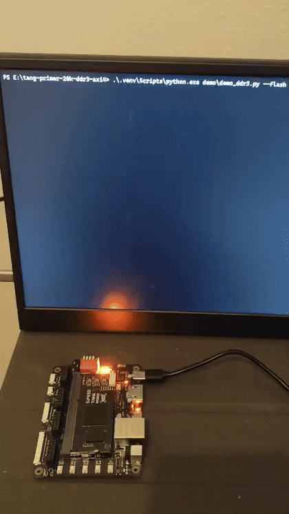

# tang-primer-20k-ddr3-axi4

Open-source **DDR3 + AXI4** memory subsystem written in **SpinalHDL** for the **Sipeed Tang Primer 20K** (`GW2A-LV18PG256C8/I7`), driving Gowin native DDR primitives (`OSER8_MEM`, `IDES8_MEM`, `DQS`, `DLL`).

> [!WARNING]
> Experimental hobby project, not proven in industrial environments. Bugs may still remain, so use it at your own risk (MIT "AS IS" license) and do not use it in critical production systems.

## Plug-and-Play Usage (`TangPrimer20kDdr3`)

Instantiate [`TangPrimer20kDdr3`](ddr3/src/ddr3/board/TangPrimer20kDdr3.scala) to get the PLL (`303.75 MHz` CK / `75.94 MHz` controller clock), Power-On-Reset, DDR3 controller, and **32 / 64 (default) / 128-bit AXI4** slave port in one block:

```scala
// 1. Standard 64-bit AXI4 in controllerClockDomain (75.94 MHz)
val ddr3 = TangPrimer20kDdr3(dataWidth = 64)
ddr3.io.sys_clk    := io.sys_clk
ddr3.io.sys_resetn := io.sys_resetn
ddr3.io.pad        <> io.pad

val userLogic = new ClockingArea(ddr3.controllerClockDomain) {
  myAxiMaster <> ddr3.io.axi
}

// 2. Or supply your own clock domain for automatic Axi4CC clock-domain crossing
val ddr3Async = TangPrimer20kDdr3(
  dataWidth      = 64,                    // 32, 64, or 128
  axiClockDomain = Some(myUserClockDomain)
)
```

## Verified Hardware Results (Tang Primer 20K)

All modes verified in Verilator (`ddr3.test`) and on physical Tang Primer 20K hardware (`pclk = 75.94 MHz`, `CK = 303.75 MHz`, including byte-masked `DDR3_DM[1:0]` writes and optional `27 MHz` async `Axi4CC`):

| Mode | Resources (`Ddr3TesterTop`) | Sequential HW Throughput (avg / peak) | Hardware Status |
|---|---|---|---|
| **32-bit** (`--32`) | `LUT=4858`, `REG=2187`, `BSRAM=1` | ~145 MB/s WR, ~241 MB/s RD *(sim)* | `1359` passes, `0` fails (`32b+CDC`: `912` passes) |
| **64-bit** *(default)* | `LUT=4941`, `REG=2245`, `BSRAM=1` | **580.0 MB/s** (`peak 586.3`) WR, **548.8 MB/s** (`peak 556.7`) RD | `1226` passes, `0` fails (`64b+CDC`: `1171` passes) |
| **128-bit** (`--128`) | `LUT=4527`, `REG=1959`, `BSRAM=5` | **~960 MB/s** (`peak ~965`) WR, **~794 MB/s** (`peak ~804`) RD | `1183` passes, `0` fails |

- **Mixed R/W, short row-miss & scalar latency (64-bit HW, 100-run avg):** `256 B` mixed R/W 100% row-miss **`387.4 MB/s`** combined (`402.0` WR / `373.8` RD), `64 B` mixed R/W 100% row-miss **`211.1 MB/s`** combined (`252.6` WR / `181.4` RD); `16 B` read latency **`19.5 cyc` (`257 ns`)** same-row hit / **`21.7 cyc` (`286 ns`)** row-miss. Full breakdown in [`doc/bench.md`](doc/bench.md).
- **AXI4 integration notes:** supports `INCR` and `FIXED` bursts (not `WRAP`), expects `AxSIZE` matching the configured bus width (use `WSTRB` for partial/sub-word writes), arbitrates one `AW` or `AR` burst at a time, and tracks a single open bank/row at a time.

## Quick PC ↔ DDR3 Demo (`demo/`)

Ready-to-run bitstream + `pyserial` visualizer in [`demo/`](demo/) (**no Mill or Gowin IDE required**: just flash the prebuilt [`Ddr3UartDemoTop.fs`](demo/Ddr3UartDemoTop.fs) via [`demo_ddr3.py`](demo/demo_ddr3.py)):

<p align="center">
  <a href="doc/demo.gif"></a>
</p>

```powershell
# Flash prebuilt demo bitstream to SRAM, round-trip an RGB image + message in DDR3,
# and display a live AXI4 Write/Read throughput & peak graph (COM8 @ 115200 baud)
.venv\Scripts\python.exe demo\demo_ddr3.py --flash --port COM8

# Or run the 100-iteration workload + row-miss + scalar latency suite
.venv\Scripts\python.exe demo\demo_ddr3.py --flash --workload --port COM8
```

*(To rebuild the demo bitstream from SpinalHDL sources: `python eda-flow.py --preset demo --skip-compile --flash openfpgaloader`.)*

> **Board tip:** if you re-flash SRAM repeatedly while the board stays powered and observe a data/calibration glitch, unplug and replug the USB cable to power-cycle the SDRAM/PHY cleanly before running `--flash`.

## Quickstart & Commands (Windows)

```powershell
setup.bat                                           # Downloads Mill + OSS CAD Suite (Verilator, openFPGALoader)

.\mill.bat -i ddr3.runMain ddr3.Ddr3Gen             # Generate Verilog in hw/gen/ (flags: --32 | --128, --cdc)
.\mill.bat -i ddr3.test                             # Run all Verilator unit tests (24 tests)

python eda-flow.py --preset ddr3 --skip-compile     # Headless Gowin synthesis & PnR -> build_eda/impl/pnr/
python fpga_run.py --timeout 12 --pass-target 0     # Flash SRAM & verify live UART memtest
```

## Repository Structure

```text
├── ddr3/src/ddr3/      # SpinalHDL sources (config/, phy/, core/, axi/, board/TangPrimer20kDdr3.scala, examples/)
├── ddr3/test/          # Verilator unit tests & formal properties (Ddr3FormalProof)
├── demo/               # Prebuilt Ddr3UartDemoTop.fs + demo_ddr3.py (UART round-trip + live MB/s graph)
├── doc/                # Design docs, benchmark report (bench.md) & demo GIF (demo.gif)
├── hw/gen/             # Pre-generated Verilog (Ddr3Controller, Ddr3Axi4, TangPrimer20kDdr3, Ddr3TesterTop, Ddr3UartDemoTop)
├── src/                # Tang Primer 20K constraints (tang20k.cst, ddr3.sdc) & Gowin_rPLL
├── eda-flow.py         # Headless Gowin synthesis, PnR & flash helper (--preset ddr3 | demo)
└── fpga_run.py         # FPGA SRAM/Flash programmer & UART test monitor
```

## Acknowledgments

This project would not have been possible without:
- **[SpinalHDL](https://spinalhdl.github.io/SpinalDoc-RTD/)** for its expressive Scala-based hardware description, `Axi4` / `Axi4CC` ecosystem, and SpinalSim/Verilator integration.
- **[nand2mario/ddr3-tang-primer-20k](https://github.com/nand2mario/ddr3-tang-primer-20k)** for the foundational Tang Primer 20K pin constraints, PLL setup, and reference Gowin DDR3 PHY bring-up.
- **LLM coding assistants** that greatly helped throughout architecture, bring-up, debugging, and verification: **Gemini** (via **Antigravity**) and **DeepSeek** (via **OpenCode**).

## License

- **SpinalHDL implementation & scripts:** [MIT License](LICENSE), Léonard Adamo ([Juste-Leo2](https://github.com/Juste-Leo2))
- **PLL wrapper & board constraints (`src/`):** [Apache License 2.0](https://www.apache.org/licenses/LICENSE-2.0), adapted from [nand2mario/ddr3-tang-primer-20k](https://github.com/nand2mario/ddr3-tang-primer-20k)
