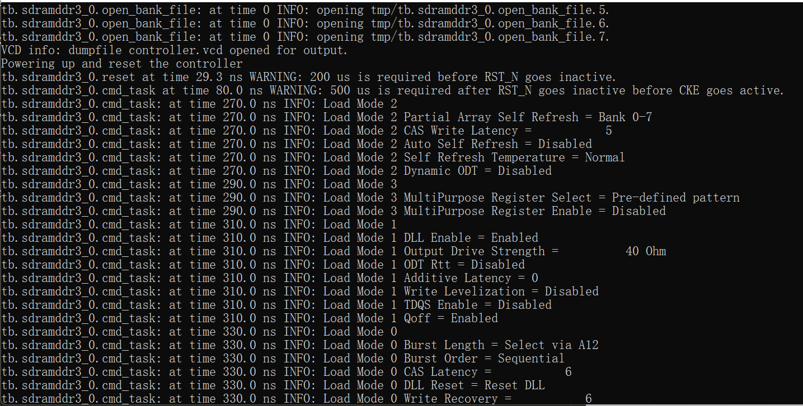
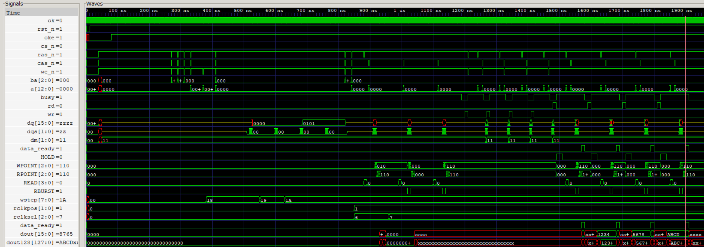

## Simulation setup using Icarus Verilog, `prim_sim.v` and Micron DDR3 model

*(Note: Vendor files are **not redistributed** in Git. For fast daily verification, use the Verilator Scala unit tests `.\mill.bat -i ddr3.test` and direct hardware runs `python fpga_run.py`.)*

If you want to run the legacy pin-level Icarus Verilog simulations against Micron's JEDEC model:

* [Icarus Verilog](https://bleyer.org/icarus/) (also bundled via `setup.bat` in `tools/oss-cad-suite/`).
* **Micron DDR3 memory model**: download **"DDR3 SDRAM Verilog Model (v1.74)"** for a 1024Mb x16 part (e.g., MT41K64M16 / MT41J64M16) from [Micron's official DDR3 catalog](https://www.micron.com/products/dram/ddr3-sdram) (*Tools / Simulation Models*). Extract and place in this directory (`archives/simulation/`, gitignored):
  * `ddr3.v` → `archives/simulation/ddr3_vanilla.v`
  * `1024Mb_ddr3_parameters.vh` → `archives/simulation/1024Mb_ddr3_parameters.vh`
  * `2048Mb_ddr3_parameters.vh` → `archives/simulation/2048Mb_ddr3_parameters.vh` *(optional)*
* **Gowin `prim_sim.v`**: bundled with your local Gowin EDA IDE installation at `<GOWIN_HOME>/IDE/simlib/gw2a/prim_sim.v` (e.g., `C:\Gowin\Gowin_V1.9.11.03_Education_x64\IDE\simlib\gw2a\prim_sim.v`). `sim_ddr.py` auto-detects `GOWIN_HOME` / `C:\Gowin\...`, or you can copy it here as `archives/simulation/prim_sim_tb.v`.

Then you can run 
```bash
make run.controller
```
(original nand2mario baseline, kept as golden reference: `tb_controller.v` +
`ddr3_controller_sim.v`; legacy `Makefile` archived in `archives/sim-legacy/`).

It gives a detailed view of what's happening, including timing errors. This is essential for debugging the controller.



With gtkwave, you can view the wavefrom:



---

## Active flow (refactoring 10/2026)

- Driver unique : `python simulation/sim_ddr.py --fast-tb --map-only` (build),
  puis `--spinal --run` / `--fast-tb --run` (voir `AGENTS.md`). Ne jamais
  lancer `vvp.exe` brut en détaché (le driver met `bin+lib` au PATH).
- TB actif : `tb_fast.v`. `tb_spinal.v` / `tb_controller.v` (+
  `ddr3_controller_sim.v`, baseline nand2mario gardée) : autres TBs.
- Batteries et analyses : voir `measure/README.md` (`measure/mag_battery.py`,
  `measure/map_capture.py`, `measure/analyze_*.py` — logs lus ici même).
- Anciens scripts d'analyse : `archives/sim-scripts/`.

